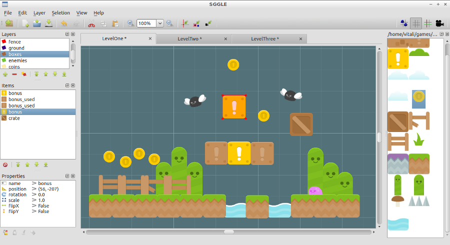
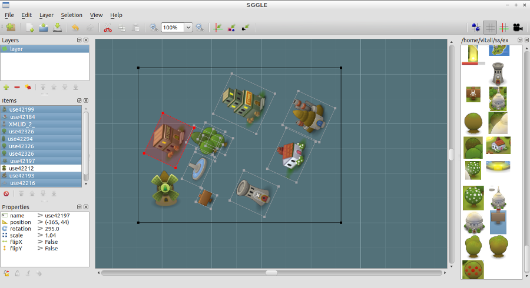
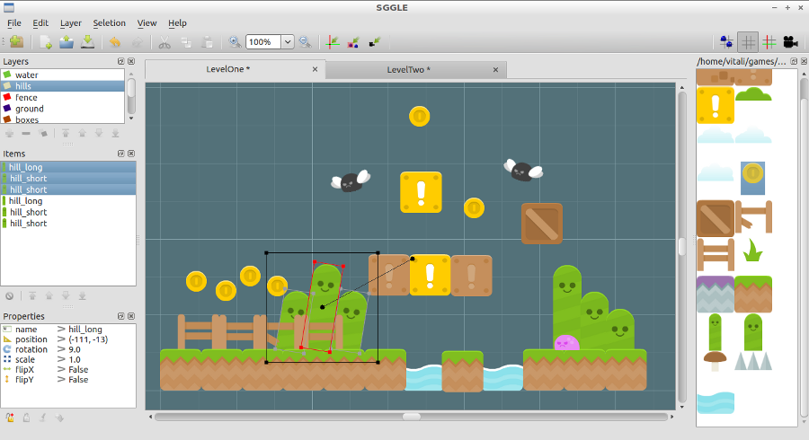

# SGGLE

> **Archived.** A solo side project from 2012, written in Python 2 and PySide / Qt 4.
> Recovered in 2026 from the Software Heritage archive after Bitbucket dropped Mercurial support.
> Kept for reference, not maintained.

SGGLE is a simple level editor for non tile based 2D games.

This tool was developed as an in house tool, so don't expect it to be feature complete.
However it's functional enough for my needs, and stable as far as i know :)

## Screenshots







## Download & Run

1. Download version 0.2.0 (the `0.2.0` tag of this repository).

2. Make sure you have Qt and PySide installed. In Ubuntu:

   ```
   apt-get install python-pyside
   ```

3. Run it:

   ```
   python sggle.py
   ```

---

This README was restored from the project's original Bitbucket wiki (last edited 2012-12-01).
